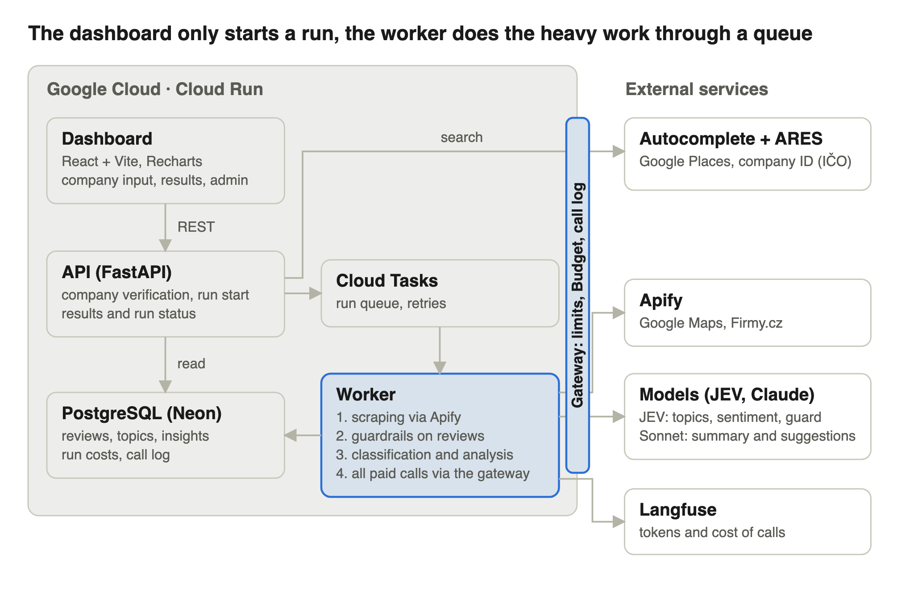
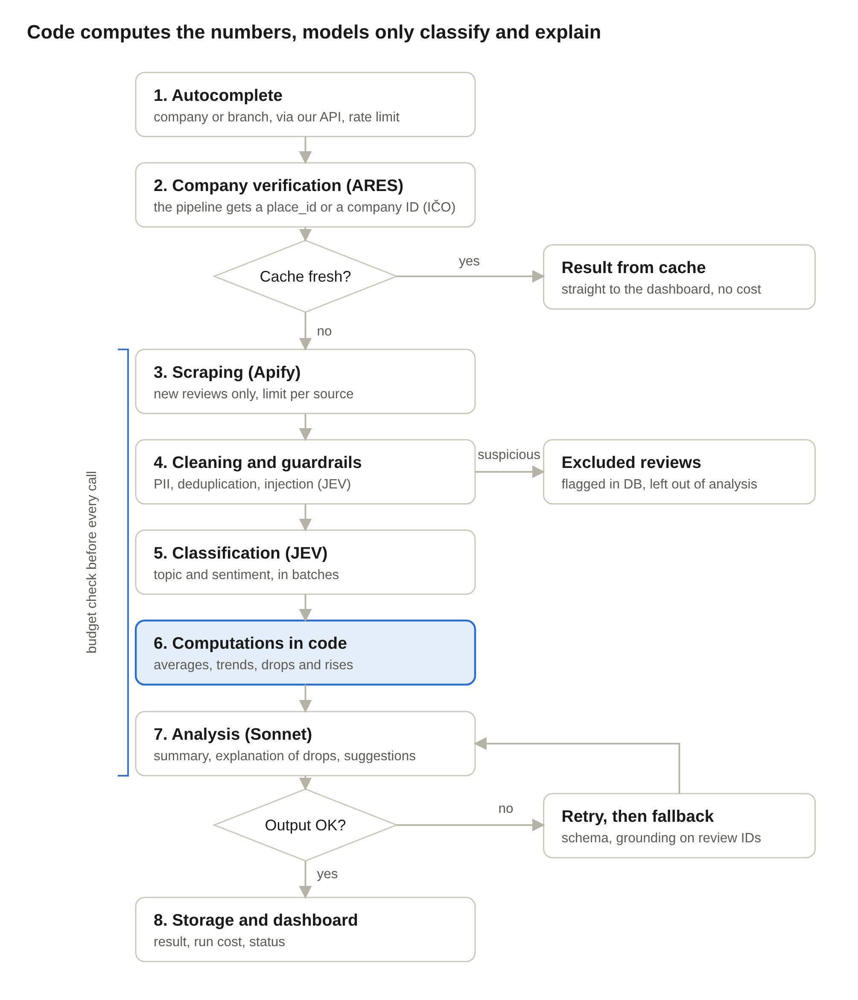

# Review Analyzer – high-level specification

## Goal and MVP scope

The user enters a company name and within a few minutes gets a dashboard: overall rating, comparison of sources, sentiment over time, review topics, an explanation of drops and suggestions for improvement. The project shows how to route between models, guardrails, cost control and cloud deployment.

**In the MVP:**

- 2 sources: Google Maps and Firmy.cz (Heureka as a third if time allows)
- one company or a specific branch chosen via an autocomplete (Google Places)
- classification of reviews into topics, sentiment, a timeline that explains drops and rises
- an overall summary and suggestions for improvement with links to reviews
- input and output checks, a budget per run, cache

**Out of the MVP:** login, regular monitoring and notifications, comparison with competitors, further sources (Trustpilot, Heureka, Mapy.com), suggested replies to reviews.

## Architecture

The dashboard only calls the API. Scraping and model calls run in a worker through a queue, so a long run does not block a request and can be retried on failure. The code is split into deep modules with clear interfaces that can be tested in isolation (see [Code structure](#code-structure-deep-modules)).

## Processing flow

A fast model classifies each review, code computes the numbers and trends, and a strong model only receives aggregated data and samples. Invalid output is retried and then replaced by a fallback result.

## Tech stack

I recommend a Python backend on Google Cloud Run: Python has the best AI ecosystem, and Cloud Run is cheap, scales to zero and the container is easy to demo.

| Layer | Technology | Why |
| --- | --- | --- |
| Frontend | React + Vite, Tailwind, Recharts | a simple dashboard, charts without custom drawing |
| API | Python, FastAPI, Pydantic | fast API, validation of inputs and LLM outputs with one library |
| Worker | Python, same image as the API | scraping and AI processing run asynchronously, outside the request |
| Task queue | Google Cloud Tasks (or Pub/Sub) | reliable triggering and retry of jobs |
| Database | PostgreSQL (Neon, free tier); pgvector only later | run state, cache, reviews, results, costs; aggregations by month and branch in SQL |
| Scraping | Apify: compass/google-maps-reviews-scraper; Firmy.cz: jupri/firmy (being tested) | ready-made scrapers, pay per use, spending limit |
| Autocomplete | Google Places Autocomplete (New) | unambiguous choice of company or branch; place_id goes straight to the scraper |
| Fast model | Jev 1.14 (TypeSafe) via OpenRouter, fallback Claude Haiku | typed classification of topics and sentiment, latency 70 to 500 ms, very cheap |
| Strong model | Claude Sonnet | summary, comparison of sources, explanation of trends, suggestions |
| Guardrails | Pydantic schemas, JEV as a prompt injection detector | detection of prompt injection in reviews, output validation |
| Observability and costs | Langfuse | prompt tracing, tokens and price of every run |
| Infra | Docker, Cloud Run, Secret Manager, GitHub Actions | container in the cloud, CI/CD, keys outside the code |
| Code quality | pytest, pytest-cov, diff-cover, ruff, mypy, import-linter, Vitest | tests and coverage in CI, checks of module boundaries |

The backend is in Python. We considered Kotlin with Ktor, but for an AI role Python is the clearer signal.

## Code structure: deep modules

The code is split into deep modules: each hides a lot of logic behind a small, stable interface. The caller does not know the internal steps, the formats of the scrapers or the concrete model provider, so every module can be tested in isolation through its interface.

**Rules**

- A module is a Python package `app/<module>/`. The public interface is in `__init__.py`: `Protocol`s and Pydantic types of inputs and outputs. Everything else is internal (`_impl`) and importing it from outside is forbidden; import-linter guards the boundaries in CI.
- Dependencies go one way: `api`/`worker` → `pipeline` → domain modules → ports. No cycles.
- External services (Apify, OpenRouter, Anthropic, Google Places, Langfuse, the database) sit behind ports (`Protocol`) only. An adapter is thin and replaceable; in tests a fake replaces it.
- Numbers and trends are pure functions without I/O. I/O stays at the edge (adapters, repositories).
- `api` and `worker` are thin layers: parse the request, call `pipeline`, serialize. No business logic.
- A module changes only at the price of an interface change; if the interface stays, the tests stay green.

**Modules**

| Module | Public interface | What it hides | How it is tested |
| --- | --- | --- | --- |
| `places` | `suggest(query)`, `resolve(place_id) -> Place`, `branches(place) -> list[Place]`, `confirm(place_ids) -> Company`, `match_other_sources(place)` | Google Places, finding candidate branches of a chain, matching a branch on Firmy.cz by name and address; a Company is the user-confirmed set of Places, the same set is the same Company | fake HTTP clients, contract tests on recorded responses |
| `sources` | `fetch_reviews(place, since, limit) -> list[RawReview]` | Apify actors, polling, pagination, field mapping, dates | fake Apify client, fixtures from real outputs |
| `sanitize` | `prepare(raw) -> PreparedReviews(clean, flagged)` | removal of HTML and hidden characters, PII, deduplication (hash), prompt injection detector | pure functions, fake detector, property-based tests |
| `taxonomy` | `get_taxonomy(industry) -> Taxonomy` | generating topics from a sample, freezing them | fake LLM port |
| `classification` | `classify(reviews, taxonomy) -> list[ReviewTopic]` | batching, Jev with fallback to Haiku, retry, schema validation | fake LLM port |
| `metrics` | `compute(reviews, topics) -> Metrics` (averages, `TrendPoint`, topic shares, drops and rises) | all computations and anomaly detection | pure functions, no mocks |
| `insights` | `generate(metrics, samples) -> Insights` | prompts, Sonnet, schema validation, grounding check (the review IDs exist), content check | fake LLM port |
| `llm` | `complete(task, prompt, schema) -> T` | providers, model routing, retry, fallback, prompt caching, Langfuse tracing | fake providers |
| `budget` | `reserve(estimate)`, `record(cost)`, `BudgetExceeded` | cost estimate, cap per run, monthly cap | pure functions |
| `storage` | repositories: `ReviewRepo`, `RunRepo`, `InsightRepo`, `TrendRepo` | SQL, migrations, cache with TTL | integration tests on PostgreSQL (testcontainers); in-memory implementation for the other modules |
| `pipeline` | `run(run_id) -> RunResult` | order of steps, run state machine, retry, partial result when the budget is exceeded | all ports as fakes, a whole run without a network |

Every new module is built in this order: interface and types, tests of the interface, implementation. A module without tests of its interface is not considered done.

## Testing and code quality

The code must be covered by tests; tests are part of every module, not extra work done later.

- **Through the interface:** tests call only the public interface of a module, not internal functions. This way the implementation can be rewritten without changing the tests.
- **Pyramid:** unit tests of modules (fast, no network) → contract tests of adapters on recorded responses → integration tests of `storage` on a real PostgreSQL → 1 to 2 end-to-end tests of `pipeline` with fake ports.
- **Mandatory scenarios:** not only the happy path. Every module covers its error paths: timeout, invalid JSON from a model, exceeded budget, empty input, prompt injection in a review, a non-existent review ID in a model response.
- **No live services in CI:** tests call neither Apify nor an LLM (cost, non-determinism). Live contract tests and the evaluation on 100 to 200 hand-labelled reviews run separately (manually or as a nightly job) and do not count toward coverage.
- **Frontend:** Vitest and Testing Library for components and chart logic, the API layer is mocked.

### Code review agent

Every change (a module or a PR) passes a separate code review agent before it is merged. The agent runs in a fresh session, so without the context of the code's author.

- It gets only the diff, this specification and a checklist, not the conversation history or the implementer's reasoning. The goal is an independent view.
- Its tools are read-only plus running tests (Read, Grep, Glob, git diff, pytest); it does not edit code. The agent definition is in the repository (`.claude/agents/code-reviewer.md`).
- It checks: adherence to the interface and boundaries of the module, depth of the module (leaking implementation, shallow wrappers), quality of tests (error paths, tests through the interface, not just the coverage number), guardrails (injection, PII, grounding), the budget check before a model call, keys and secrets in code, readability.
- The output is a list of findings with severity (blocker, major, minor), location (file:line) and a suggested fix. Blockers and majors are fixed before the merge.
- The author fixes in the original session; a repeated review always runs in a new fresh session.
- The review ends with the marker `<!-- code-reviewer: <sha> -->`, which CI uses to verify that a review exists. One round: at most 5 blocking findings, each with a concrete failing case. Details, agents, hooks and workflow rules are in [Agentic development](agentic-development.md).

### CI: coverage check

GitHub Actions runs these steps on every PR, and merging into `main` is blocked until all of them pass (branch protection):

1. `ruff` (lint, format) and `mypy --strict`
2. `import-linter`: module boundaries and direction of dependencies
3. `pytest --cov=app --cov-branch --cov-fail-under=90`: overall line and branch coverage of at least 90 % and at least 80 % in every file (the coverage table goes to the job summary, falling below the threshold names the file)
4. `diff-cover --fail-under=90`: new or changed code must be covered at least 90 %, so that coverage cannot be "diluted" by old code
5. Vitest with `--coverage` and an 80 % threshold for the frontend
6. Coverage report as an artifact and a comment on the PR
7. `review-passed`: a PR that is not a draft must have a review by the `code-reviewer` agent of a commit from this PR, and its last review must report no open blocking findings (the last line of the review is a marker with the SHA and `blocking=<n>`; `n` must be 0)
8. Checks of critical paths and guardrail paths, check of the PR body and gitleaks (see [Agentic development](agentic-development.md#ci-checks))

The modules `metrics`, `sanitize`, `budget` and `llm` have a stricter threshold of 95 %; they are critical paths, for which CI fails also when source changes without a change of tests. The threshold must not be lowered; exclusions from coverage (tests, migrations, `__main__`) are explicit in the configuration with a reason. Coverage is a necessary, not a sufficient condition: the quality of tests is judged by the code review agent.

## Guardrails

The main attack vector is not the input field but the reviews themselves: they are foreign, untrusted texts that go into the LLM (indirect prompt injection).

**User input**

- company name: length, allowed characters, rate limit per IP
- the autocomplete is called through our API (the API key is not in the browser, rate limit, debounce); the pipeline receives a place_id, not free text

**Reviews (untrusted data)**

- normalization: removal of HTML and hidden characters, length trimming, deduplication
- removal of personal data (reviewer names are not stored, GDPR)
- prompt injection detector; suspicious reviews are flagged and excluded from the analysis
- in the prompt, reviews are always delimited as data (tags with IDs), and the system prompt says that instructions inside them are ignored

**Model output**

- structured JSON validated by a Pydantic schema, retry on error, then fallback
- grounding: every claim and suggestion carries review IDs, and it is checked that these IDs exist
- all numbers (averages, trends, topic shares) are computed by code, the model only comments on them
- content check: no personal data, insults or claims outside the data
- evaluation: 100 to 200 hand-labelled reviews to measure classification accuracy

## Cost control

Every run has a fixed budget and its actual cost is shown on the dashboard. The monthly cap is 30 USD, per-run limits will be set after the first measurement.

- **Cache:** the result for a target (a branch, or a company = the same set of branches) is reused while it is fresh (e.g. 24 h); a new run downloads only new reviews
- **Input limits:** max. number of reviews per source and branch, max. review length
- **Model routing:** bulk work (classification) is done by a cheap model in batches, the expensive model receives only aggregated data and samples of reviews
- **Token savings:** prompt caching for system prompts, Batch API for non-urgent runs
- **Budget per run:** the price estimate is checked before every call; when exceeded, the run stops with a partial result
- **Provider limits:** spending limit in Apify and in the model API keys, a daily limit of runs per user
- **Measurement:** Langfuse records tokens and price of every call, a run has the sum of costs of Apify and the models

## Data model

A database is needed: the worker runs asynchronously, so run state, cache and already downloaded reviews must live somewhere between requests. Nine entities in PostgreSQL are enough; reviews are stored once and analyses over them can be repeated.

| Entity | Main fields | Purpose |
| --- | --- | --- |
| Company | id, places_key (hash of the sorted place_ids), name, industry | a set of branches confirmed by the user; the same set is the same Company |
| Place | source, external_id, branch name, address | a branch on a specific source (Google Maps, Firmy.cz) |
| CompanyPlace | company_id, place_id | membership of a Place in a Company; one Place can be in several Companies |
| Review | place_id, source, rating, text, date, date precision, language, hash, flagged | a review without personal data |
| Topic | key, name, description, industry | taxonomy of topics (e.g. staff, waiting, prices) |
| ReviewTopic | review_id, topic_id, sentiment, confidence | result of the classification |
| AnalysisRun | company_id, status, budget, cost USD, tokens, time | one pipeline run and its costs |
| Insight | run_id, type (summary, anomaly, suggestion), period, text, review_ids | output of the strong model with links to reviews |
| TrendPoint | run_id, source, period, average, count, sentiment | precomputed points of the timeline |

## Dashboard

Three screens: search, run progress and result.

1. **Search:** a field with an autocomplete that offers companies and specific branches (name, address). The choice decides whether the whole chain or a single branch is analyzed.
2. **Progress:** steps of the run (downloading, classification, analysis) with a running cost.
3. **Result:**
    - overall rating and rating by source (Google Maps vs. Firmy.cz) with the number of reviews
    - timeline of the average rating and sentiment, with markers on drops and rises and the main topic ("March: waiting at the checkout")
    - topics: share of positive and negative mentions, specific reviews on click
    - comparison of branches by rating and main problems
    - verbal and numerical assessment of the development and suggestions for improvement with links to reviews
    - cost of the run (Apify, models) and the number of excluded suspicious reviews

## Decisions

All open questions are decided, except how the branches of a chain are found (research ticket #16); two things also remain to be verified for Jev and the scrapers.

| Question | Decision | Consequence |
| --- | --- | --- |
| Fast model | [Jev 1.14 by TypeSafe AI](https://typesafe.ai/blog/introducing-system-one-models-and-jev) via the [OpenRouter](https://openrouter.ai/typesafe/jev-1.14) Decisions API, fallback Claude Haiku | classification of topics and sentiment and prompt injection detection; typed output, $0.042 per 1M input tokens, output free, latency about 0.12 s; we do not use Jev Router (automatic LLM choice), routing is in code |
| Backend | Python + FastAPI | API and worker in one image |
| Topic taxonomy | generated per industry | an LLM proposes topics from a sample of reviews once per industry, then they are frozen and JEV classifies every review into them |
| Autocomplete | Google Places Autocomplete (New) | place_id goes straight to the Google Maps scraper; a branch on Firmy.cz is matched by name and address; Mapy.com dropped out |
| Firmy.cz | an Apify actor first, our own scraper if there are problems | no actor documents reviews with a date; we will test [jupri/firmy](https://apify.com/jupri/firmy) and [oodoow/mapy-com-ppe](https://apify.com/oodoow/mapy-com-ppe); anonymously only 3 reviews per company are visible, terms of use still need to be resolved |
| Review dates | a scraper with an exact date | Google Maps: [compass/google-maps-reviews-scraper](https://apify.com/compass/google-maps-reviews-scraper) (field publishedAtDate in ISO, filter reviewsStartDate), deduplication by reviewId; Firmy.cz shows an exact date, the actor needs to be verified |
| Budget | up to 30 USD per month | set spending limits in Apify and in the API keys accordingly |
| Code architecture | deep modules with a clear interface, external services only behind ports | every module is tested in isolation with fake dependencies |
| Tests and coverage | coverage of at least 90 % (branches and lines), diff coverage 90 %, checked in CI | a merge is blocked when coverage is lower |
| Code review | a separate agent in a fresh session before every merge, CI checks that the review exists | an independent view without the author's context |
| Agentic development | rules, agents, hooks and CI checks, a [separate document](agentic-development.md) | every rule has an enforcer or is marked as a process rule |
| Demo access | links with a token | a precomputed analysis of a selected company plus the option to try another |

**Still to verify:**

- [ ] Branch discovery for a chain: Google Places text search by name, filtered by name and address, plus user confirmation; precision on 3 real companies
- [ ] Jev: whether it handles Czech (50 real reviews labelled by a model and corrected by a human, plus about 15 synthetic injection attacks; go if sentiment agreement is at least 80 %, topics at least 70 % and no injection false negatives, otherwise Haiku only; test key limited to 5 USD) and a client for the OpenRouter Decisions API, which is not OpenAI-compatible
- [ ] Test run: jupri/firmy and oodoow/mapy-com-ppe (date, review ID, more than 3 reviews?) and a comparison of older dates from compass with Google Maps
