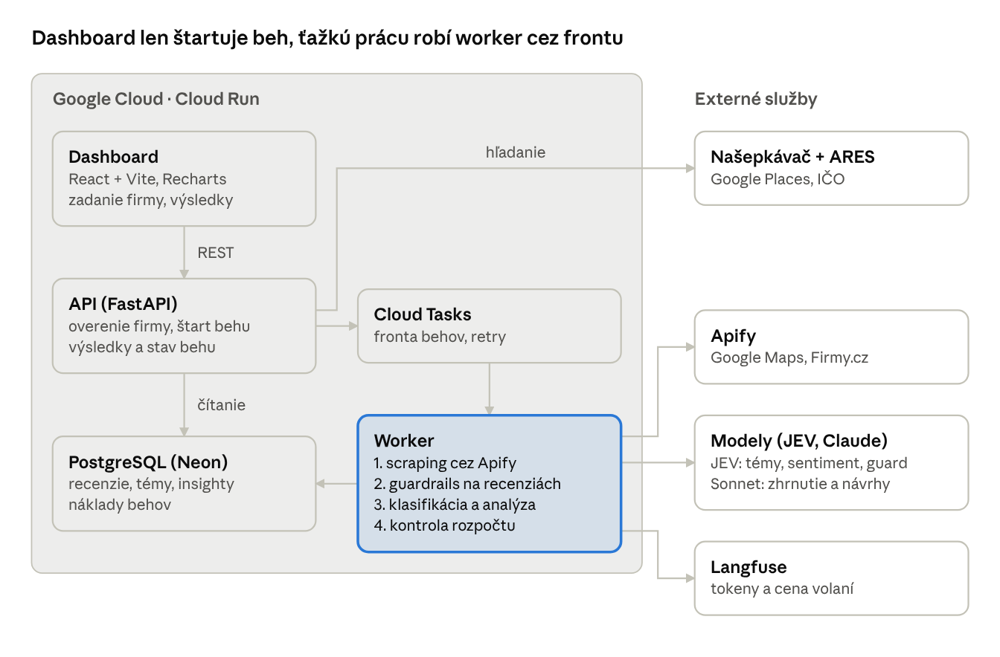
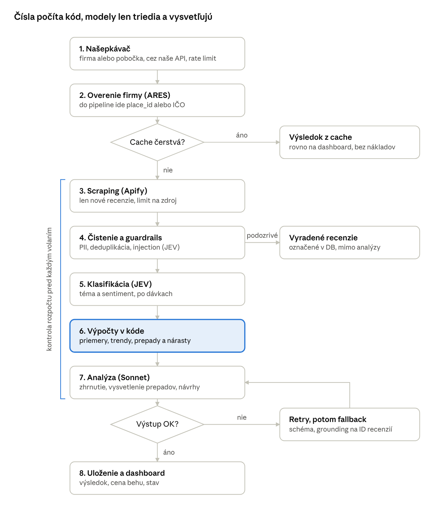

# Review Analyzer – high-level špecifikácia

## Cieľ a rozsah MVP

Používateľ zadá názov firmy a do pár minút dostane dashboard: celkové hodnotenie, porovnanie zdrojov, vývoj sentimentu v čase, témy recenzií, vysvetlenie prepadov a návrhy na zlepšenie. Projekt ukazuje smerovanie medzi modelmi, guardrails, cost control a nasadenie v cloude.

**V MVP:**

- 2 zdroje: Google Maps a Firmy.cz (Heureka ako tretí, ak zostane čas)
- jedna firma alebo konkrétna pobočka vybraná cez našepkávač (Google Places), firma overená cez IČO (ARES)
- klasifikácia recenzií do tém, sentiment, časová os s vysvetlením prepadov a nárastov
- celkové zhrnutie a návrhy na zlepšenie s odkazmi na recenzie
- vstupné a výstupné kontroly, rozpočet na jeden beh, cache

**Mimo MVP:** prihlasovanie, pravidelný monitoring a notifikácie, porovnanie s konkurenciou, ďalšie zdroje (Trustpilot, Heureka, Mapy.com), návrhy odpovedí na recenzie.

## Architektúra

Dashboard volá len API. Scraping a volania modelov bežia vo workeri cez frontu, takže dlhý beh neblokuje request a pri chybe sa dá zopakovať.

## Tok spracovania

Rýchly model triedi každú recenziu, čísla a trendy počíta kód a silný model dostane len agregované dáta a vzorky. Neplatný výstup sa zopakuje a potom nahradí záložným výsledkom.

## Tech stack

Odporúčam Python backend na Google Cloud Run: Python má najlepší AI ekosystém a Cloud Run je lacný, škáluje na nulu a kontajner sa dá ľahko ukázať.

| Vrstva | Technológia | Prečo |
| --- | --- | --- |
| Frontend | React + Vite, Tailwind, Recharts | jednoduchý dashboard, grafy bez vlastného kreslenia |
| API | Python, FastAPI, Pydantic | rýchle API, validácia vstupov aj výstupov LLM jednou knižnicou |
| Worker | Python, rovnaký image ako API | scraping a AI spracovanie bežia asynchrónne, mimo requestu |
| Fronta úloh | Google Cloud Tasks (alebo Pub/Sub) | spoľahlivé spúšťanie a retry jobov |
| Databáza | PostgreSQL (Neon, free tier); pgvector až neskôr | stav behov, cache, recenzie, výsledky, náklady; agregácie po mesiacoch a pobočkách v SQL |
| Scraping | Apify: compass/google-maps-reviews-scraper; Firmy.cz: jupri/firmy (v teste) | hotové scrapery, platba za použitie, limit výdavkov |
| Našepkávač a overenie | Google Places Autocomplete (New), ARES API | jednoznačný výber firmy alebo pobočky; place_id ide rovno do scrapera, IČO identifikuje firmu |
| Rýchly model | Jev 1.14 (TypeSafe) cez OpenRouter, záloha Claude Haiku | typovaná klasifikácia tém a sentimentu, odozva 70 až 500 ms, veľmi lacná |
| Silný model | Claude Sonnet | zhrnutie, porovnanie zdrojov, vysvetlenie trendov, návrhy |
| Guardrails | Pydantic schémy, JEV ako detektor prompt injection | detekcia prompt injection v recenziách, validácia výstupu |
| Observabilita a náklady | Langfuse | tracing promptov, tokeny a cena na každý beh |
| Infra | Docker, Cloud Run, Secret Manager, GitHub Actions | kontajner v cloude, CI/CD, kľúče mimo kódu |

Backend je v Pythone. Kotlin s Ktor sme zvážili, ale pre AI rolu je Python čitateľnejší signál.

## Guardrails

Hlavný vektor útoku nie je vstupné pole, ale samotné recenzie: sú to cudzie, nedôveryhodné texty, ktoré idú do LLM (nepriama prompt injection).

**Vstup od používateľa**

- názov firmy: dĺžka, povolené znaky, rate limit na IP
- našepkávač sa volá cez naše API (API kľúč nie je v prehliadači, rate limit, debounce); do pipeline ide place_id alebo IČO, nie voľný text

**Recenzie (nedôveryhodné dáta)**

- normalizácia: odstránenie HTML, skrytých znakov, orezanie dĺžky, deduplikácia
- odstránenie osobných údajov (mená recenzentov sa neukladajú, GDPR)
- detektor prompt injection; podozrivé recenzie sa označia a vyradia z analýzy
- v prompte sú recenzie vždy oddelené ako dáta (tagy s ID), systémový prompt hovorí, že pokyny v nich sa ignorujú

**Výstup z modelov**

- štruktúrovaný JSON validáciou cez Pydantic schému, pri chybe retry, potom fallback
- grounding: každé tvrdenie a návrh má ID recenzií, kontroluje sa, že tieto ID existujú
- všetky čísla (priemery, trendy, podiely tém) počíta kód, model ich len komentuje
- kontrola obsahu: žiadne osobné údaje, urážky ani tvrdenia mimo dát
- evaluácia: 100 až 200 ručne označených recenzií na meranie presnosti klasifikácie

## Cost control

Každý beh má pevný rozpočet a jeho skutočná cena sa zobrazí na dashboarde. Mesačný strop je 30 USD, limity na jeden beh nastavíme po prvom meraní.

- **Cache:** výsledok pre firmu sa znovu použije, kým je čerstvý (napr. 24 h); pri novom behu sa sťahujú len nové recenzie
- **Limity vstupu:** max. počet recenzií na zdroj a pobočku, max. dĺžka recenzie
- **Smerovanie modelov:** hromadnú prácu (klasifikácia) robí lacný model po dávkach, drahý model dostane len agregované dáta a vzorky recenzií
- **Šetrenie tokenov:** prompt caching pre systémové prompty, Batch API pri neurgentných behoch
- **Rozpočet na beh:** pred každým volaním sa kontroluje odhad ceny; po prekročení sa beh zastaví s čiastočným výsledkom
- **Limity u poskytovateľov:** spending limit v Apify a v API kľúčoch modelov, denný limit behov na používateľa
- **Meranie:** Langfuse eviduje tokeny a cenu na každé volanie, beh má súčet nákladov za Apify aj modely

## Dátový model

Databáza je potrebná: worker beží asynchrónne, takže stav behu, cache a už stiahnuté recenzie musia niekde žiť medzi requestmi. Stačí osem entít v PostgreSQL; recenzie sa ukladajú raz a analýzy nad nimi sa dajú opakovať.

| Entita | Hlavné polia | Účel |
| --- | --- | --- |
| Company | id, názov, IČO, odvetvie | firma overená cez ARES |
| Place | company_id, zdroj, external_id, názov pobočky, adresa | pobočka na konkrétnom zdroji (Google Maps, Firmy.cz) |
| Review | place_id, zdroj, hodnotenie, text, dátum, presnosť dátumu, jazyk, hash, flagged | recenzia bez osobných údajov |
| Topic | kľúč, názov, popis, odvetvie | taxonómia tém (napr. personál, čakanie, ceny) |
| ReviewTopic | review_id, topic_id, sentiment, istota | výsledok klasifikácie |
| AnalysisRun | company_id, stav, rozpočet, cena USD, tokeny, čas | jeden beh pipeline a jeho náklady |
| Insight | run_id, typ (zhrnutie, anomália, návrh), obdobie, text, review_ids | výstup silného modelu s odkazmi na recenzie |
| TrendPoint | run_id, zdroj, obdobie, priemer, počet, sentiment | predpočítané body časovej osi |

## Dashboard

Tri obrazovky: vyhľadávanie, priebeh behu a výsledok.

1. **Vyhľadávanie:** pole s našepkávačom, ktoré ponúka firmy aj konkrétne pobočky (názov, adresa, IČO). Výber určí, či sa analyzuje celá sieť, alebo jedna pobočka.
2. **Priebeh:** kroky behu (sťahovanie, klasifikácia, analýza) s priebežnou cenou.
3. **Výsledok:**
    - celkové hodnotenie a hodnotenie podľa zdrojov (Google Maps vs. Firmy.cz) s počtom recenzií
    - časová os priemerného hodnotenia a sentimentu, na prepadoch a nárastoch značky s hlavnou témou („brezen: čakanie pri pokladni“)
    - témy: podiel pozitívnych a negatívnych zmienok, po kliknutí konkrétne recenzie
    - porovnanie pobočiek podľa hodnotenia a hlavných problémov
    - slovné a číselné zhodnotenie vývoja a návrhy na zlepšenie s odkazmi na recenzie
    - cena behu (Apify, modely) a počet vyradených podozrivých recenzií

## Rozhodnutia

Všetky otvorené otázky sú rozhodnuté, overiť treba už len dve veci pri Jev a scraperoch.

| Otázka | Rozhodnutie | Dôsledok |
| --- | --- | --- |
| Rýchly model | [Jev 1.14 od TypeSafe AI](https://typesafe.ai/blog/introducing-system-one-models-and-jev) cez [OpenRouter](https://openrouter.ai/typesafe/jev-1.14) Decisions API, záloha Claude Haiku | klasifikácia tém a sentimentu aj detekcia prompt injection; typovaný výstup, $0.042 za 1M vstupných tokenov, výstup zadarmo, odozva cca 0,12 s; Jev Router (automatický výber LLM) nepoužívame, smerovanie je v kóde |
| Backend | Python + FastAPI | API aj worker v jednom image |
| Taxonómia tém | generovaná pre odvetvie | LLM navrhne témy zo vzorky recenzií raz pre odvetvie, potom sa zafixujú a JEV do nich triedi každú recenziu |
| Našepkávač | Google Places Autocomplete (New) | place_id ide rovno do Google Maps scrapera; pobočka na Firmy.cz sa páruje podľa názvu a adresy; Mapy.com vypadol |
| Firmy.cz | najprv Apify actor, pri problémoch vlastný scraper | žiadny actor nemá v dokumentácii recenzie s dátumom; otestujeme [jupri/firmy](https://apify.com/jupri/firmy) a [oodoow/mapy-com-ppe](https://apify.com/oodoow/mapy-com-ppe); anonymne sú viditeľné len 3 recenzie na firmu, podmienky použitia treba ešte vyriešiť |
| Dátumy recenzií | scraper s presným dátumom | Google Maps: [compass/google-maps-reviews-scraper](https://apify.com/compass/google-maps-reviews-scraper) (pole publishedAtDate v ISO, filter reviewsStartDate), deduplikácia podľa reviewId; Firmy.cz zobrazuje presný dátum, actor treba overiť |
| Rozpočet | do 30 USD mesačne | spending limity v Apify a v API kľúčoch nastaviť podľa toho |
| Prístup k demu | odkazy s tokenom | predpočítaná analýza vybranej firmy plus možnosť skúsiť ďalšiu |

**Zostáva overiť:**

- [ ] Jev: či zvláda češtinu (test na ručne označených recenziách) a klient pre OpenRouter Decisions API, ktoré nie je OpenAI-kompatibilné
- [ ] Testovací beh: jupri/firmy a oodoow/mapy-com-ppe (dátum, ID recenzie, viac ako 3 recenzie?) a porovnanie starších dátumov z compass s Google Maps
